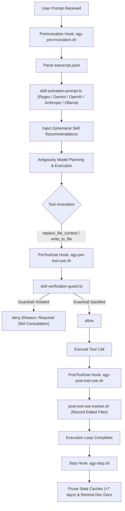

# Antigravity (agy) Skills & Infrastructure Template

A curated, production-tested master library of skills, lifecycle hooks, specialized subagents, and development workflows for Google Antigravity (`agy`).

This repository serves as a **central template and reference library**. You can copy components into your own projects, author new skills, or scaffold an entire project setup using the included wizard.

---

## Table of Contents

- [Overview & Philosophy](#overview--philosophy)
- [Directory Architecture](#directory-architecture)
- [Included Production Skills](#included-production-skills)
- [Quick Start](#quick-start)
  - [Automated Scaffolding (`setup.ts`)](#automated-scaffolding-setupts)
  - [Manual Integration](#manual-integration)
  - [Verifying Health (`verify-setup.sh`)](#verifying-health-verify-setupsh)
- [Integration Guide: Cherry-Picking into Your Projects](#integration-guide-cherry-picking-into-your-projects)
  - [Tech Stack Compatibility Check](#tech-stack-compatibility-check)
  - [Step-by-Step Cherry-Picking](#step-by-step-cherry-picking)
  - [Customizing Path Patterns in `skill-rules.json`](#customizing-path-patterns-in-skill-rulesjson)
  - [Adapting Skills for Other Stacks](#adapting-skills-for-other-stacks)
- [Antigravity Lifecycle Hooks Engine](#antigravity-lifecycle-hooks-engine)
  - [How Hooks Work in Antigravity](#how-hooks-work-in-antigravity)
  - [Execution Flow](#execution-flow)
  - [The Antigravity Hook Adapters](#the-antigravity-hook-adapters)
- [Activation Modes & AI Provider Setup](#activation-modes--ai-provider-setup)
  - [Activation Modes](#activation-modes)
  - [Conservativeness Tuning](#conservativeness-tuning)
  - [Provider Configuration (Gemini, OpenAI, Anthropic, Ollama)](#provider-configuration-gemini-openai-anthropic-ollama)
- [Specialized Subagents Catalog](#specialized-subagents-catalog)
- [Slash Commands & Workflow Extensions](#slash-commands--workflow-extensions)
- [Dev Docs Context System (`dev/active/`)](#dev-docs-context-system-devactive)
- [Authoring New Skills (Best Practices)](#authoring-new-skills-best-practices)
  - [The 500-Line Rule & Progressive Disclosure](#the-500-line-rule--progressive-disclosure)
  - [Skill Directory Structure](#skill-directory-structure)
  - [YAML Frontmatter Format](#yaml-frontmatter-format)
  - [Registering Triggers](#registering-triggers)
  - [Skill Validation Script](#skill-validation-script)
- [Troubleshooting & FAQs](#troubleshooting--faqs)
- [License](#license)


---

## Overview & Philosophy

AI coding assistants often fail to consult project-specific conventions at the right moment. Asking developers to remember to explicitly prompt the agent with `@skill-name` creates friction, while dumping thousands of lines of instructions into the prompt wastes tokens and degrades model reasoning.

This template solves that dilemma using two battle-tested principles:

1. **Progressive Disclosure (The 500-Line Rule)**:
   Skills keep their root `SKILL.md` under 500 lines. The agent only loads the high-level runbook into context. Deeper reference materials (API tables, code templates, edge cases) reside in subdirectories (`resources/`, `references/`) and are fetched only when needed.

2. **Automated Lifecycle Hooks (`hooks.json`)**:
   Antigravity hooks evaluate prompts and file modifications in real time. They suggest relevant skills *before* the model answers and enforce guardrails *before* the agent writes code.

---

## Directory Architecture

Antigravity natively discovers customizations by inspecting `.agents/` in the project root, along with root rule files (`AGENTS.md` and `GEMINI.md`):

```text
skills/
├── AGENTS.md                  # Root Antigravity rules and project guidelines
├── README.md                  # Master documentation and reference guide
├── setup.ts                   # Project scaffolding and self-verification wizard
│
├── .agents/                   # Canonical Antigravity configuration directory
│   ├── hooks.json             # Lifecycle hooks configuration
│   ├── skills.json            # Explicit skill path declarations
│   │
│   ├── skills/                # Production-tested modular skills
│   │   ├── web-design-guidelines/      # Vercel UI/UX, accessibility & performance
│   │   │   └── SKILL.md
│   │   ├── frontend-dev-guidelines/   # React 18+, MUI v7, TanStack Query & Router
│   │   │   ├── SKILL.md
│   │   │   └── resources/
│   │   ├── backend-dev-guidelines/    # Node.js/Express, Prisma, layered architecture
│   │   │   ├── SKILL.md
│   │   │   └── resources/
│   │   ├── error-tracking/            # Sentry v8 monitoring & transactions
│   │   │   └── SKILL.md
│   │   ├── skill-developer/           # Meta-skill for authoring skills & triggers
│   │   │   └── SKILL.md
│   │   ├── source-command-verify-setup/# Health check diagnostic runner
│   │   │   └── SKILL.md
│   │   ├── skill-rules.json           # Trigger registry (keywords, regex, paths)
│   │   └── README.md
│   │
│   ├── agents/                # 8 specialized subagent definitions
│   │   ├── code-architecture-reviewer.md
│   │   ├── documentation-architect.md
│   │   ├── frontend-error-fixer.md
│   │   ├── full-stack-feature-developer.md
│   │   ├── plan-reviewer.md
│   │   ├── refactor-planner.md
│   │   ├── test-driven-developer.md
│   │   └── ui-ux-designer.md
│   │
│   ├── commands/              # Slash commands specifications
│   │   ├── dev-docs.md
│   │   ├── dev-docs-update.md
│   │   ├── route-research-for-testing.md
│   │   └── verify-setup.md
│   │
│   ├── hooks/                 # Lifecycle hook engine and Antigravity adapters
│   │   ├── agy-pre-invocation.sh      # PreInvocation: extracts prompt, suggests skills
│   │   ├── agy-pre-tool-use.sh        # PreToolUse: gates edits via guardrails
│   │   ├── agy-post-tool-use.sh       # PostToolUse: tracks edited files
│   │   ├── agy-stop.sh                # Stop: cleans cache & issues dev doc reminders
│   │   ├── skill-activation-prompt.ts # Multi-provider AI & regex classifier
│   │   ├── skill-verification-guard.ts# Guardrail verification engine
│   │   ├── package.json               # Hook dependencies
│   │   └── lib/                       # SQLite session intelligence & telemetry
│   │
│   └── scripts/               # Diagnostic & maintenance scripts
│       ├── verify-setup.sh            # 9-point health check
│       ├── validate-skills.sh         # Frontmatter & 500-line validator
│       └── skill-stats.sh             # Telemetry & performance reporter
│
└── dev/                       # Dev docs context directory
    └── active/                # Task briefs surviving context resets
```

---

## Included Production Skills

| Skill | Tech Stack / Focus | Purpose |
|---|---|---|
| [**`web-design-guidelines`**](.agents/skills/web-design-guidelines/SKILL.md) | Vercel Web Standards | Concise rules for accessible, fast, delightful web UIs. Keyboard navigation, touch targets (≥44px mobile), focus rings, reduced motion, CLS prevention, and form hydration. |
| [**`frontend-dev-guidelines`**](.agents/skills/frontend-dev-guidelines/SKILL.md) | React 18+, MUI v7, TanStack | Modern React patterns, Suspense data fetching, TanStack Router, MUI v7 layout updates (Grid `size` prop), and `features/` directory architecture. |
| [**`backend-dev-guidelines`**](.agents/skills/backend-dev-guidelines/SKILL.md) | Node.js, Express, Prisma, TS | Layered backend microservice architecture (`routes` → `controllers` → `services` → `repositories`), `BaseController` abstraction, Zod validation, and DI. |
| [**`error-tracking`**](.agents/skills/error-tracking/SKILL.md) | Sentry v8 | Comprehensive error tracking, span instrumentation, database query tracing, and cron job monitoring. |
| [**`skill-developer`**](.agents/skills/skill-developer/SKILL.md) | Tech-agnostic Meta-skill | Comprehensive guide to authoring skills, designing regex triggers, configuring guardrails, and enforcing progressive disclosure. |
| [**`source-command-verify-setup`**](.agents/skills/source-command-verify-setup/SKILL.md) | Antigravity Health | Self-healing runner for infrastructure diagnostics and fixes. |

---

## Quick Start

### Requirements
- **Node.js 18+** (20+ recommended)
- **macOS or Linux** (WSL2 required on Windows for shell hooks)
- **jq** (optional, recommended for JSON parsing in hooks: `brew install jq` or `apt install jq`)

---

### Automated Scaffolding (`setup.ts`)

The fastest way to deploy this entire infrastructure into another project is via the setup wizard:

```bash
# Run from inside this template repo pointing to your target project:
npx tsx setup.ts /path/to/target-project --yes

# With AI-enhanced classification (Gemini free tier):
npx tsx setup.ts /path/to/target-project --yes --mode fallback --provider gemini
```

**What the setup wizard does:**
1. Inspects your target project's `package.json` to detect its tech stack (React, Express, Prisma, MUI, etc.).
2. Copies `.agents/` (skills, agents, commands, hooks, scripts, configs) and root `AGENTS.md`.
3. Makes hook scripts executable (`chmod +x`).
4. Updates `skill-rules.json` with the selected activation mode and conservativeness.
5. Installs hook dependencies in the target project.
6. Runs `verify-setup.sh` to ensure all diagnostics pass.

---

### Manual Integration

If you prefer to copy components manually:

```bash
# 1. Copy the .agents directory into your project
cp -R .agents /path/to/target-project/
cp AGENTS.md /path/to/target-project/

# 2. Install hook dependencies
cd /path/to/target-project/.agents/hooks && npm install

# 3. Make scripts executable
chmod +x /path/to/target-project/.agents/hooks/*.sh /path/to/target-project/.agents/scripts/*.sh

# 4. Verify installation
bash /path/to/target-project/.agents/scripts/verify-setup.sh
```

---

### Verifying Health (`verify-setup.sh`)

Run the health check at any time:

```bash
bash .agents/scripts/verify-setup.sh
```

**Diagnostic checks executed:**
- Node.js runtime version (>= 18)
- `.agents/hooks.json` syntax and structure
- Executable permissions on hook scripts
- Hook npm dependencies (`better-sqlite3`, `tsx`, `@types/node`)
- `skill-rules.json` syntax and trigger structure
- AI provider key or local server availability (when AI mode is enabled)
- `jq` utility availability
- Skill directory presence and integrity
- End-to-end simulated prompt test verifying that hooks activate matching skills

---

## Integration Guide: Cherry-Picking into Your Projects

When bringing components from this template into another project, you don't have to copy everything. You can cherry-pick only what you need.

### Tech Stack Compatibility Check

Before integrating a skill, verify whether the project's stack matches:

#### 1. Frontend Skills
- **`web-design-guidelines`**: Works with **ANY web project** (HTML, CSS, React, Vue, Svelte, Next.js, Astro).
- **`frontend-dev-guidelines`**: Tailored for React 18+ + MUI v7 + TanStack Query/Router.
  - *If using Vue, Svelte, or Tailwind*: Adapt the file organization and performance principles, but replace MUI and React-specific code (see [Adapting Skills](#adapting-skills-for-other-stacks)).

#### 2. Backend Skills
- **`backend-dev-guidelines`**: Tailored for Node.js + Express + Prisma + TypeScript.
  - *If using NestJS, Fastify, Django, or Go*: Extract the layered architecture principles (`routes` → `controllers` → `services` → `repositories`), which apply to any framework.

#### 3. Tech-Agnostic Components
- **`skill-developer`**: Universal meta-skill.
- **`error-tracking`**: Sentry patterns transfer to any language or monitoring provider.
- **All Agents**: Standalone prompts ready for any project.

---

### Step-by-Step Cherry-Picking

1. **Copy the desired skill directory**:
   ```bash
   cp -r .agents/skills/web-design-guidelines /path/to/target/.agents/skills/
   ```

2. **Register the skill in `skill-rules.json`**:
   Add the trigger definition to the target project's `.agents/skills/skill-rules.json`.

3. **Customize path patterns**:
   Update `pathPatterns` to match your target project's source tree (e.g. `src/`, `apps/web/`, `packages/api/`).

4. **Verify**:
   ```bash
   bash .agents/scripts/validate-skills.sh
   bash .agents/scripts/verify-setup.sh
   ```

---

### Customizing Path Patterns in `skill-rules.json`

File triggers automatically notify the agent or block edits based on the file paths being touched:

#### Monorepo Setup (Workspaces, Turborepo, Nx):
```json
{
  "backend-dev-guidelines": {
    "fileTriggers": {
      "pathPatterns": [
        "packages/api/src/**/*.ts",
        "packages/server/src/**/*.ts",
        "apps/backend/**/*.ts"
      ]
    }
  },
  "frontend-dev-guidelines": {
    "fileTriggers": {
      "pathPatterns": [
        "apps/web/src/**/*.tsx",
        "packages/ui/src/**/*.tsx"
      ]
    }
  }
}
```

#### Standard Single Application:
```json
{
  "backend-dev-guidelines": {
    "fileTriggers": {
      "pathPatterns": [
        "src/api/**/*.ts",
        "src/controllers/**/*.ts",
        "src/services/**/*.ts"
      ]
    }
  }
}
```

---

### Adapting Skills for Other Stacks

If you use a different framework (e.g., Vue instead of React, or Fastify instead of Express):

1. **Duplicate the base skill**:
   ```bash
   cp -r .agents/skills/frontend-dev-guidelines .agents/skills/vue-dev-guidelines
   ```
2. **Systematically replace framework code**:
   - `React.FC` → Vue `defineComponent` or `<script setup>`
   - `useSuspenseQuery` → Vue composables / TanStack Query Vue
   - MUI components → Vuetify / PrimeVue / Tailwind
   - Keep: File organization, performance rules, TypeScript standards.
3. **Update `SKILL.md` frontmatter & triggers in `skill-rules.json`**:
   Set `pathPatterns` to `**/*.vue` and update keyword triggers.

---

## Antigravity Lifecycle Hooks Engine

### How Hooks Work in Antigravity

Antigravity executes external shell commands at specific lifecycle points defined in `.agents/hooks.json`:

- **`PreInvocation`**: Fires right after the user submits a prompt, before the model plans or acts.
- **`PreToolUse`**: Fires before a tool runs (e.g., before `replace_file_content` or `write_to_file`).
- **`PostToolUse`**: Fires immediately after a tool finishes execution.
- **`Stop`**: Fires when the execution turn completes.

### Execution Flow



### The Antigravity Hook Adapters

1. **`agy-pre-invocation.sh`**:
   - Reads Antigravity's `transcriptPath` metadata.
   - Extracts the latest user prompt.
   - Matches keywords and intent patterns against `skill-rules.json`.
   - Injects recommendations via `ephemeralMessage` into the context so the model sees the guidance without permanently bloating the chat transcript.

2. **`agy-pre-tool-use.sh`**:
   - Inspects `replace_file_content` and `write_to_file` calls.
   - Matches the target file path against guardrails in `skill-rules.json`.
   - If a mandatory skill has not been consulted in the session, blocks the edit with `{"decision": "deny", "reason": "..."}`, instructing the agent on the required action.

3. **`agy-post-tool-use.sh`**:
   - Records edited files to `.agents/hooks/cache/` for route research and session intelligence.
   - Returns `{}`.

4. **`agy-stop.sh`**:
   - Prunes stale session cache files older than 7 days.
   - Triggers reminders to update `dev/active/` documentation if working on tracked tasks.

---

## Activation Modes & AI Provider Setup

### Activation Modes

Configured in `.agents/skills/skill-rules.json`:

```json
{
  "settings": {
    "skill_activation_mode": "disabled",
    "conservativeness": "balanced"
  }
}
```

| Mode | Behavior | Cost | Offline |
|---|---|---|---|
| **`disabled`** (Default) | Classic regex & keyword matching | Free | Yes |
| **`fallback`** | AI semantic classification with silent regex fallback | ~$0.001/prompt | Graceful |
| **`ai-only`** | Pure AI classification | ~$0.001/prompt | No |

### Conservativeness Tuning

| Level | Description | Recommended For |
|---|---|---|
| **`strict`** | Activates only on explicit stated intent | Large skill sets, experienced users |
| **`balanced`** (Default) | Standard matching: mandatory for direct work, suggestions for context | Most projects |
| **`aggressive`** | Suggests liberally on tangential mentions | New team members, onboarding |

### Provider Configuration

If you choose `fallback` or `ai-only` mode, configure an AI provider:

#### 1. Gemini (Recommended - Free Tier)
1. Get a key at [Google AI Studio](https://aistudio.google.com/apikey).
2. Set in your environment or in `.agents/hooks/.env`:
   ```bash
   export GEMINI_API_KEY="your-key-here"
   ```

#### 2. OpenAI
```bash
export OPENAI_API_KEY="your-key-here"
```

#### 3. Anthropic
```bash
export ANTHROPIC_API_KEY="your-key-here"
```

#### 4. Ollama (100% Local & Free)
1. Install [Ollama](https://ollama.ai).
2. Pull a fast classification model:
   ```bash
   ollama pull llama3.2 && ollama serve
   ```
   No API keys required!

---

## Specialized Subagents Catalog

Located in [`.agents/agents/`](.agents/agents/), these subagents can be delegated to for specialized, multi-step tasks:

- **`code-architecture-reviewer`**: Reviews pull requests and code modifications against clean architecture and separation-of-concerns principles.
- **`documentation-architect`**: Authors comprehensive developer documentation, API specifications, and architecture overviews.
- **`frontend-error-fixer`**: Diagnoses and resolves build errors, TypeScript mismatches, and browser runtime issues.
- **`full-stack-feature-developer`**: Implements end-to-end features spanning database migrations, API routes, and frontend UI.
- **`plan-reviewer`**: Audits implementation plans for security risks, edge cases, and scope creep before code is written.
- **`refactor-planner`**: Analyzes code structure, duplication, and anti-patterns to draft step-by-step refactoring roadmaps.
- **`test-driven-developer`**: Implements unit and integration test suites following TDD red-green-refactor cycles.
- **`ui-ux-designer`**: Reviews and designs user interfaces adhering to accessibility, contrast, motion, and interaction standards.

---

## Slash Commands & Workflow Extensions

Located in [`.agents/commands/`](.agents/commands/):

- **`/dev-docs`**: Initializes structured task documentation in `dev/active/` that persists context across session resets.
- **`/dev-docs-update`**: Summarizes turn progress and updates active task briefs.
- **`/route-research-for-testing`**: Inspects recently modified API routes and outputs cURL test commands with realistic payloads.
- **`/verify-setup`**: Runs the 9-point health check and automatically resolves broken configurations.

---

## Dev Docs Context System (`dev/active/`)

Long-running tasks often span multiple sessions or face context window resets. The Dev Docs pattern ensures continuity:

1. **Start a substantial task**: Create a folder in `dev/active/<feature-name>/`.
2. **Store task briefs**:
   - `task.md`: Requirements, acceptance criteria, and checklist.
   - `architecture.md`: Selected patterns and data flows.
3. **Session resets**: When starting a fresh session, instruct Antigravity:
   > "Read the active task in `dev/active/<feature-name>/` and continue from the next uncompleted checklist item."

---

## Authoring New Skills (Best Practices)

### The 500-Line Rule & Progressive Disclosure

To keep Antigravity fast and responsive:
- **`SKILL.md` must be ≤ 500 lines**. It should act as an executable runbook containing clear steps, decisions, and checks.
- Detailed reference material, long schemas, and large code samples should live in subdirectories:
  - `resources/`: Code samples, architecture patterns, templates.
  - `references/`: API specifications, comprehensive manuals.
  - `scripts/`: Helper shell or TypeScript scripts.

### Skill Directory Structure

```text
.agents/skills/<skill-name>/
├── SKILL.md            # Required: Main instruction file with frontmatter
├── resources/          # Optional: Reusable patterns and templates
├── references/         # Optional: Detailed reference documentation
└── scripts/            # Optional: Executable utilities
```

### YAML Frontmatter Format

Every `SKILL.md` must start with valid YAML frontmatter:

```markdown
---
name: my-specialized-skill
description: >-
  Concise explanation of what the skill does and when the agent should use it.
  Written in third-person. Example: "Use when designing, reviewing, or implementing
  GraphQL schemas, resolvers, or mutation inputs."
---

# My Specialized Skill

Step-by-step guidance begins here...
```

### Registering Triggers

In `.agents/skills/skill-rules.json`:

```json
"my-specialized-skill": {
    "type": "domain",
    "enforcement": "suggest",
    "priority": "high",
    "description": "Short summary",
    "promptTriggers": {
        "keywords": ["graphql", "resolver", "mutation"],
        "intentPatterns": ["\\b(create|add|implement)\\b.*?\\b(resolver|mutation|graphql)s?\\b"]
    },
    "fileTriggers": {
        "pathPatterns": ["src/graphql/**/*.ts", "**/*.graphql"]
    }
}
```

### Skill Validation Script

Run the validator to audit all skills for frontmatter, line count limits, and rule registration:

```bash
bash .agents/scripts/validate-skills.sh
```

---

## Troubleshooting & FAQs

### Q: Why didn't a skill trigger automatically?
1. Run `bash .agents/scripts/verify-setup.sh` to ensure all checks pass.
2. Check `.agents/skills/skill-rules.json` to verify that your prompt contains a matching keyword or intent regex pattern.
3. If using file triggers, verify that `pathPatterns` matches your actual directory structure.
4. Test the trigger manually from your terminal:
   ```bash
   printf '{"session_id":"test","prompt":"your test prompt"}' | bash .agents/hooks/skill-activation-prompt.sh
   ```

### Q: Can I use this with Antigravity IDE and Antigravity CLI (`agy`)?
Yes! Antigravity CLI (`agy`), Antigravity 2.0, and Antigravity IDE all discover customizations under `.agents/` and execute `.agents/hooks.json`.

### Q: How do I check telemetry on which skills are being used?
Run the built-in telemetry reporter:
```bash
bash .agents/scripts/skill-stats.sh
```
It displays suggestion counts, user conversions, and blocked edits per skill.

### Q: How do I update dependencies or rebuild SQLite?
```bash
cd .agents/hooks && npm install && npm rebuild better-sqlite3
```

---

## License

This project is licensed under the [MIT License](LICENSE).

